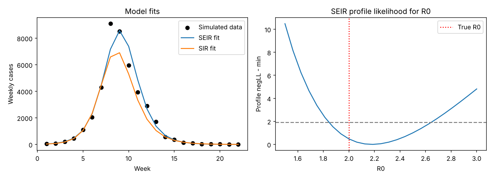

# SEIR vs SIR: fitting by maximum likelihood

A learning project in compartmental transmission modelling and likelihood-based inference.

## What it does
- Simulates a deterministic SEIR epidemic and adds negative-binomial observation noise to weekly case counts
- Fits SEIR and SIR models by maximum likelihood (Nelder-Mead, multiple starts)
- Checks parameter recovery against the known truth
- Compares models by AIC
- Computes a profile-likelihood interval for R0

## Run it
python seir_fit.py

## Results (seed 42)
| Model | R0 | AIC |
|-------|----|-----|
| SEIR | 2.18 | 252.5 |
| SIR | 1.71 | 269.1 |
True R0 = 2.0. SEIR profile-likelihood 95% interval: 1.88 to 2.62.

## Limitations
- Simulated data, deterministic model
- Latent period and population size assumed known
- Reporting rate fixed at 100%
- Not validated on real surveillance data

